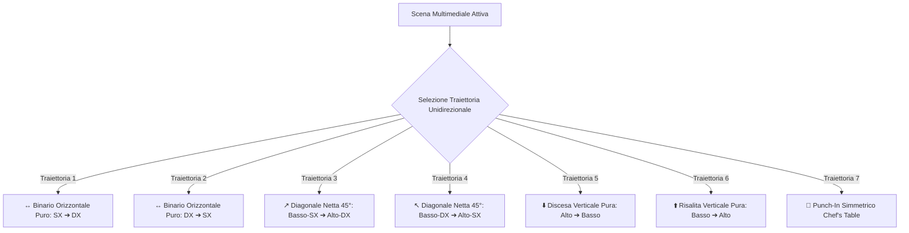
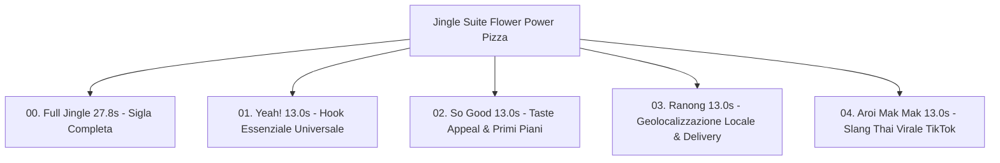

# 🎬 MASTER BLUEPRINT: MOTORE SEMANTICO DEI TESTI & REGIA CINEMATICA DINAMICA (PAN & SCAN)
**Documento Ufficiale Permanente di Architettura & Ingegneria dei Contenuti Multimediali**  
*Flower Power Social Studio — TikTok, Instagram Reels, Facebook & Google Maps*  
*Rif: Reparto Stagno `/social` — Koh Phayam & Ranong*

---

## 📌 SOMMARIO ESECUTIVO & FILOSOFIA DI DESIGN
Tutti i contenuti multimediali (Reel 9:16, caroselli TikTok Photo Mode, post Facebook e schede Google Maps) prodotti dal **Flower Power Social Studio** devono sottostare a due motori ingegneristici permanenti e inviolabili:

1. **PILASTRO 1 — Semantic Text Composition Engine (`formatSemanticLines`)**:  
   Garantisce che ogni scritta in sovrimpressione rispetti la punteggiatura strutturale, i connettori logici, la morfologia del tailandese nativo, l'estetica editoriale a sinistra, il design *Glassmorphism Minimal Chic* del prezzo e la verità assoluta del prodotto (zero falsità su forni a legna).
2. **PILASTRO 2 — Cinematic Camera & Pan-Scan Motion Engine**:  
   Sfrutta la natura orizzontale nativa (16:9 / 3:2) delle fotografie dei piatti e del resort per generare movimenti di camera fluidi e cinematografici a 60 FPS dentro l'inquadratura verticale 9:16 (pan orizzontali sinistra➔destra, scivolamenti diagonali, push-in lenti), eliminando per sempre la noia del semplice zoom centrale statico.

---

# 🖋️ PARTE 1: MOTORE DI COMPOSIZIONE SEMANTICA DEI TESTI

### 1.1 Gerarchia Visiva Obbligatoria per Reparto
* **Pizzeria Ranong (`brand: 'pizza'`)**:
  * **Tailandese SEMPRE PRIMA**: Titolo principale in grande, marcato e dominante (`Noto Sans Thai`, 28px in Canvas, font-black in HTML).
  * **Inglese SUBITO SOTTO**: Sottotitolo elegante, più compatto e descrittivo.
  * **Italiano**: Riservato a badge d'origine o descrizioni gastro-culturali.
* **Resort Koh Phayam (`brand: 'village'`)**:
  * **Inglese PRIMA**: Titolo principale per il turismo e i viaggiatori internazionali.
  * **Tailandese SUBITO SOTTO**: Sottotitolo caldo e accogliente con particelle viral blogger (`นะคะ`, `จ้า`, `พักผ่อนฮีลใจ`).

---

### 1.2 Regola dei Due Punti (`:`) e Punteggiatura Forte
Quando una sovrimpressione contiene i due punti (`:`), trattini (`—`) o pipe (`|`):
* **Il testo PRIMA del `:`** costituisce la prima riga autonoma (es. *Categoria*, *Gancio Emozionale*, *Serie*).
* **Il testo DOPO il `:`** va tassativamente a capo sulla seconda riga come *Soggetto Speciale*.
* **DIVIETO ASSOLUTO DI TAGLIO ARBITRARIO**: È categoricamente vietato spezzare parole a metà.
  * ✅ **CORRETTO**:
    ```text
    I Re dello Street Food:
    Burger & Focacce
    ```
  * ❌ **VIETATO**:
    ```text
    I Re dello Street Food: Bur-
    ger & Focacce
    ```
  * ✅ **CORRETTO (Thai)**:
    ```text
    ราชาแห่งสตรีทฟู้ด:
    เบอร์เกอร์และฟอคัชชา
    ```

---

### 1.3 Vocabolario dei Connettori Logici Protetti
Se una clausola supera la larghezza massima del canvas o della card, il motore deve individuare e mandare a capo solo prima dei seguenti connettori certificati:
* **Italiano**: ` CON `, ` & `, ` CON IL `, ` CON LA `
* **Inglese**: ` & `, ` WITH `, ` AND `, ` BY THE `
* **Tailandese**: ` พร้อม `, ` และ `, ` สไตล์ `, ` สูตร `

---

### 1.4 Segmentazione Morfologica Protetta del Thai (`Intl.Segmenter`)
La lingua tailandese è priva di spazi interverbali. I browser moderni e il motore Canvas utilizzano l'API:
```typescript
new Intl.Segmenter('th', { granularity: 'word' })
```
Questo assicura che il testo non venga mai interrotto all'interno di una sillaba o di un gruppo consonantico/vocalico, preservando il significato naturale e la pronuncia.

---

### 1.5 Price Tag "Glassmorphism Minimal Chic"
* **Bando Totale alle Emoji Kitsch**: Eliminato qualsiasi sacchetto dei soldi `💰` o rettangolo arancione piatto che abbassi il prestigio del locale.
* **Specifiche Tecniche del Badge Luxury**:
  * **Sfondo**: Vetro scuro satinato semitrasparente (`rgba(15, 23, 42, 0.85)` / `bg-stone-950/85 backdrop-blur-md`).
  * **Micro-bordo**: Filetto metallico dorato/ambra sottile `1px` (`rgba(245, 158, 11, 0.55)`).
  * **Gemma Luminosa**: Punto ambra/oro `3px` pulsante a sinistra del prezzo.
  * **Tipografia**: Cifra numerica in bianco brillante `font-black 15px` + valuta `THB` in ambra `font-bold 11px`.

---

### 1.6 Blindatura Verità del Prodotto (Zero Forno a Legna)
* **DIVIETO CATEGORICO E ASSOLUTO**: Mai usare le parole "forno a legna", "wood-fired", "เตาฟืน" o "Holzofenpizza" per la pizzeria.
* **Veri Punti di Forza Certificati**:
  * 100% Farina di Grano Italiano Certificata.
  * Lenta Lievitazione Naturale di 48 Ore ad Alta Digeribilità.
  * Chef Italiano Autentico.
  * Pomodoro San Marzano DOP, Mozzarella Fior di Latte, Burrata Pugliese e Salumi Italiani DOP.
  * Cottura Tradizionale su Pietra Refrattaria ad Alta Temperatura.

---

### 1.7 Geometria "Piatto Libero" (Layout Editoriale a Sinistra)
* **Coordinate a Sinistra**: Testi posizionati stabilmente a `posX = 28px` da sinistra, con gradiente scuro inferiore per garantire massimo contrasto tipografico.
* **Centro Piatto Sgombro**: Il centro della pizza o del piatto deve rimanere completamente visibile, appetitoso e valorizzato dalle particelle animate di vapore caldo a 60 FPS.

---

# 🎥 PARTE 2: MOTORE DI REGIA CINEMATICA DINAMICA (PAN & SCAN)

### 2.1 Il Principio Geometrico: Il Margine Nascosto (Panorama 16:9 ➔ Canvas 9:16)
Una fotografia orizzontale in alta risoluzione presenta un aspect ratio tipico di `1.5` - `1.77`. Quando viene proiettata su un Canvas verticale 9:16 (`aspectRatio = 0.5625`), l'altezza copre l'intero schermo (`drawH = 960px`) mentre la larghezza totale generata è:
$$\text{drawW} = 960 \times 1.77 \approx 1700\text{px}$$
A fronte di un canvas largo solo `540px`, **esistono ben 1160px di dettagli orizzontali nascosti oltre i bordi**.  
Il nostro motore trasforma questo spazio "cieco" in una sequenza cinematografica dinamica.

---

### 2.2 Il Catalogo dei 7 Movimenti Unidirezionali Puri (Zero Altalene, A ➔ B e Fine)



1. **`pan_left_to_right` (Binario Orizzontale Puro SX ➔ DX)**:
   * **Asse Y = 0 (Zero Deriva)**, Scala 1.15 fissa.
   * La camera parte da tutto a sinistra e viaggia a velocità costante e vellutata **esclusivamente verso destra**. Un solo movimento continuo da A a B, zero oscillazioni.
2. **`pan_right_to_left` (Binario Orizzontale Puro DX ➔ SX)**:
   * **Asse Y = 0 (Zero Deriva)**, Scala 1.15 fissa.
   * La camera parte da tutto a destra e viaggia **esclusivamente verso sinistra**.
3. **`diagonal_up_right` (Diagonale Netta a 45° Basso-SX ➔ Alto-DX)**:
   * Taglia l'immagine in linea retta a 45° precisi dall'angolo inferiore sinistro a quello superiore destro.
4. **`diagonal_up_left` (Diagonale Netta a 45° Basso-DX ➔ Alto-SX)**:
   * Taglia l'immagine in linea retta a 45° precisi dall'angolo inferiore destro a quello superiore sinistro.
5. **`tilt_top_to_bottom` (Discesa Verticale Pura Alto ➔ Basso)**:
   * **Asse X = 0 (Zero Deriva)**, Scala 1.18 fissa.
   * La camera parte dalla cima del piatto/scena e scende dritta verso il bordo inferiore.
6. **`tilt_bottom_to_top` (Risalita Verticale Pura Basso ➔ Alto)**:
   * **Asse X = 0 (Zero Deriva)**, Scala 1.18 fissa.
   * La camera parte dalla base e sale dritta verso la parte superiore.
7. **`push_in_focal` (Punch-In Diretto Simmetrico)**:
   * **Assi X e Y = 0 (Zero Spostamenti Laterali)**.
   * Uno zoom dritto potente e simmetrico (da 1.05x a 1.28x) verso il centro del piatto.

---

### 2.3 Interpolazione Matematica: Monotonic Quad Ease-In-Out (Zero Ritorno Indietro)
Per eliminare categoricamente l'effetto "altalena" o oscillazione da barca a vela (causato dalle sinusoidi `Math.sin`), il motore adotta una progressione monotonica pura dove $t$ viaggia rigorosamente da $0.0$ a $1.0$ e **non torna mai indietro**:
```typescript
const t = subElapsed < 0.5 
  ? 2 * subElapsed * subElapsed 
  : 1 - Math.pow(-2 * subElapsed + 2, 2) / 2;
```
Questo garantisce un'accelerazione impercettibile in partenza (*ease-in*), una velocità centrale costante e una frenata morbida sul punto d'arrivo B (*ease-out*), identica a quella dei dolly professionali cinematografici.

---

### 2.4 Lo Stacco (Cut Cinematografico tra le Scene)
* **Nelle Collezioni Multi-Piatto**: La Scena 1 compie il suo movimento da A a B; allo scadere della durata c'è lo stacco netto (*cut*) sul piatto successivo che esegue un movimento completamente diverso.
* **Nel Singolo Piatto Iconico**: Il ciclo temporizzato alterna continuamente le inquadrature (es. carrellata orizzontale ➔ stacco su discesa verticale ➔ stacco su punch-in ➔ stacco su diagonale 45°), creando un montaggio ritmato e coinvolgente che non ripete mai lo stesso asse.

---

### 2.5 🏰 REGOLA FERREA ALLOGGI VILLAGGIO (Website Assets)
* **Principio Ingegneristico (Visibilità 100% dell'Alloggio)**:
  Gli alloggi, le ville e i bungalow del villaggio sono composizioni panoramiche orizzontali (letto matrimoniale, arredi, patio in legno, amaca, finestre tropicali e giardino). Se si applica un tilt verticale o uno zoom punch-in centrale, i lati della stanza vengono tagliati fuori dal canvas 9:16 verticale e l'ospite non riesce a vedere l'intero alloggio.
* **Le Sole 4 Traiettorie Consentite Tassativamente**:
  Per tutte le foto del villaggio provenienti dal website (`brand === 'village'` con asset da catalogo/website), la camera DEVE eseguire **SOLO ED ESCLUSIVAMENTE** una di queste 4 traiettorie:
  1. ↔️ **Da Sinistra verso Destra** (`pan_left_to_right`)
  2. ↔️ **Da Destra verso Sinistra** (`pan_right_to_left`)
  3. ↗️ **Dall'Angolo Inferiore Sinistro all'Angolo Superiore Destro** (`diagonal_up_right`)
  4. ↖️ **Dall'Angolo Inferiore Destro all'Angolo Superiore Sinistro** (`diagonal_up_left`)
  * **DIVIETO ASSOLUTO**: Mai nessun altro tipo di effetto (zero tilt verticale discesa/salita e zero punch-in centrale).
* **Partenza Differenziata per Ciascun Alloggio (Zero Ripetitività All'Avvio)**:
  Per evitare che tutte le anteprime o video partano banalmente da sinistra verso destra:
  * Ogni singolo alloggio possiede la propria traiettoria iniziale assegnata in modo univoco e deterministico (`getVillageAccommodationTrajectory`):
    * **Villa Penthouse**: parte sempre da ↔️ *Sinistra verso Destra* (`pan_left_to_right`)
    * **Red Bungalow**: parte sempre da ↔️ *Destra verso Sinistra* (`pan_right_to_left`)
    * **Yellow Bungalow**: parte sempre in ↗️ *Diagonale Basso-SX ➔ Alto-DX* (`diagonal_up_right`)
    * **Bungalow Successivi**: partono in ↖️ *Diagonale Basso-DX ➔ Alto-SX* (`diagonal_up_left`) o a rotazione deterministica continua.
  * In questo modo, appena un alloggio viene selezionato o inserito in una sequenza, **inizia immediatamente con una regia cinematografica differente**, senza dover attendere 8 secondi.
* **Eccezione Telegram / Cloud Storage**:
  Questa limitazione riguarda specificamente le foto ufficiali degli alloggi prese dal website. Se in futuro verranno inserite foto e clip registrate sul campo e caricate direttamente tramite Telegram nel cloud (`source: 'telegram_cloud'`), la regola non si applicherà e saranno sbloccati tutti gli effetti.

---

# 🌟 PARTE 3: MOTORE DELLE SOVRIMPRESSIONI GRAFICHE & ATMOSFERA POLIMORFICA

Per superare la monotonia di elementi grafici sempre uguali o ripetitivi, il motore Canvas 9:16 a 60 FPS integra **8 profili di sovrimpressione grafica volumetrica polimorfica**, con una rotazione dinamica automatica ad ogni cambio scena o tempo:

```mermaid
graph TD
    A[Sovrimpressione & Trasparenze Grafiche] --> B{Selezione Profilo Coerente}
    B -->|Opzione 0| C[🌿 Nessun Effetto (Puro / Solo Cinema Ken Burns)]
    B -->|Effetto 1| D[⚡ Righe di Luce Cinematografiche Passanti (Scanning Sheen)]
    B -->|Effetto 2| E[💎 Rombi & Prismi Geometrici Minimal Chic (Diamonds)]
    B -->|Effetto 3| F[✦ Stelle Dorate Gourmet a 4 Punte (Sparks)]
    B -->|Effetto 4| G[🌀 Forme Geometriche Astratte & Bokeh Poligonali]
    B -->|Effetto 5| H[❤️ Cuori Fluttuanti Trasparenti (Made with Love)]
    B -->|Effetto 6| I[☀️ Raggi di Sole Tropicali (Phayam God Rays)]
    B -->|Effetto 7| J[💨 Vapore Caldo Ascendente (Gourmet Steam)]
```

0. **`none` (🌿 Nessun Effetto / Immagine Pura & Tipografia Editoriale)**:
   * Nessuna sovrimpressione grafica: l'inquadratura fotografica brilla al naturale con il solo movimento cinematografico Ken Burns e i testi editoriali.
1. **`light_streaks` (⚡ Righe di Luce Cinematografiche / Scanning Sheen)**:
   * Fasci di luce anamorfici paralleli inclinati a 35° che attraversano orizzontalmente lo schermo da sinistra a destra, simulando il bagliore delle lenti cinematografiche degli spot televisivi d'alta gamma.
2. **`geometric_diamonds` (💎 Rombi & Prismi Geometrici Minimal Chic)**:
   * Rombi vettoriali in vetro satinato traslucido con micro-bordo dorato a 1px (`rgba(245,158,11,0.85)`) che ruotano dolcemente a velocità differenziata e fluttuano nello spazio.
3. **`sparkle_stars` (✦ Stelle Dorate a 4 Punte / Gourmet Sparks)**:
   * Stelle vettoriali a 4 punte disegnate con `quadraticCurveTo`, pulsazione armonica a 2.4 Hz, alone ambra dorato e centro bianco brillante. Ideali per dolci, pizze gourmet e carte dei vini.
4. **`abstract_bokeh` (🌀 Forme Geometriche Astratte & Bokeh Poligonali)**:
   * Esagoni e dischi luminosi traslucidi semitrasparenti sovrapposti di diametri diversi (14-38px) che fluttuano in profondità di campo, conferendo un'estetica astratta da fotografia moderna ad altissima apertura (f/1.4).
5. **`floating_hearts` (❤️ Cuori Fluttuanti Trasparenti)**:
   * Cuori vettoriali generati con curve di Bézier in tonalità corallo/rosa con micro-bordo bianco, che salgono con un leggero ondeggiamento sinusoidale per San Valentino o piatti "Made with Italian Love".
6. **`tropical_sunbeams` (☀️ Raggi di Sole Tropicali / God Rays)**:
   * Fasci radiali dorati volumetrici dall'angolo alto che scendono morbidamente, ideali per ville panoramiche e resort sul mare a Koh Phayam.
7. **`warm_steam` (💨 Vapore Caldo Naturale Ascendente)**:
   * Particelle termiche semitrasparenti con raggio crescente e dissolvenza morbida. Perfette per pizze tradizionali, calzoni e primi fumanti appena sfornati.

---

### 3.1 Regola Ferrea: "Un Solo Effetto Coerente per Clip (Zero Alternanza)"
Per garantire la massima pulizia estetica e scongiurare qualsiasi confusione visiva:
* **Effetto Singolo per Tutta la Clip**: L'effetto scelto (dall'utente o in `auto_context`) rimane **UNICO E COSTANTE** per l'intera durata del video (tutti i 7.8 secondi). È severamente vietato alternare o mescolare effetti diversi all'interno dello stesso reel.
* **Selezione Intelligente `auto_context`**: L'effetto viene determinato in modo fisso dal contesto del piatto/alloggio:
  - Per il **Villaggio Koh Phayam**: seleziona deterministicalmente un'atmosfera coerente tra `tropical_sunbeams`, `abstract_bokeh` o `light_streaks`.
  - Per la **Pizzeria Ranong**: per piatti caldi e pizze usa `warm_steam`, per il resto `light_streaks` o `sparkle_stars`.

### 3.2 Transizioni Morbide Multi-Scena (`cross_dissolve`)
Nei caroselli o collezioni multi-scena:
* Ogni scena dura `7.8s / N_SCENE`.
* Negli ultimi **0.55 secondi** di ciascuna scena, la transizione alla successiva avviene tramite **`cross_dissolve` (dissolvenza incrociata cinematografica morbida)** con curva sinusoidale `0.5 - 0.5 * cos(t * π)`, evitando qualsiasi stacco brusco.

---

---

# 🎵 PARTE 4: SONIC BRANDING & JINGLE SUITE UFFICIALE (5 STEM R&B SOUL)

Per creare un riflesso condizionato pavloviano e dare a **Flower Power Pizza** un'identità sonora proprietaria universale su TikTok, Instagram Reels, Facebook e YouTube Shorts, è stata creata e integrata una **suite di 5 stem audio ufficiali R&B Neo-Soul contemporanei**:



### 4.1 Caratteristiche Tecniche & Precisione Metrica Broadcast

| Taglio | File Statico (`/public/audio/`) | Frame Audio | Durata | Frequenza | Canali | Bitrate | Destinazione Editoriale |
| :--- | :--- | :---: | :---: | :---: | :---: | :---: | :--- |
| **`00. Full`** | `00-flower-power-jingle-full.mp3` | 1.159 | **27.82s** | 48.000 Hz | Stereo | 64-128 kbps | Video lunghi, storytelling, caroselli complessi e reel estesi |
| **`01. Yeah`** | `01-flower-power-yeah.mp3` | **543** | **13.03s** | 48.000 Hz | Stereo | 128 kbps | Hook iniziale, apertura dinamica a forte impatto per ogni pubblico |
| **`02. So Good`** | `02-flower-power-so-good.mp3` | **543** | **13.03s** | 48.000 Hz | Stereo | 128 kbps | Primi piani appetitosi, formaggi filanti, focacce gourmet, foodies |
| **`03. Ranong`** | `03-flower-power-ranong.mp3` | **543** | **13.03s** | 48.000 Hz | Stereo | 128 kbps | Promozioni locali Ranong, delivery a domicilio, turisti ed expat |
| **`04. Aroi Mak Mak`** | `04-flower-power-aroi-mak-mak.mp3` | **543** | **13.03s** | 48.000 Hz | Stereo | 128 kbps | Clienti tailandesi, virali TikTok Thailandia, post biculturali |

### 4.2 Principi di Produzione & Muxing Video a 60 FPS
1. **In Battuta Metrica Esatta (Zero Sfasamento)**:
   Tutte le 4 tracce corte (01, 02, 03, 04) possiedono **esattamente 543 frame MPEG-1 Layer 3 a 48.000 Hz** (13.03 secondi). Questa sincronia matematica permette cambi di traccia in corsa senza alterare il ritmo della clip.
2. **Audio Nativo Broadcast (48 kHz)**:
   Il campionamento a 48.000 Hz è nativo per i formati video web (senza bisogno di risampling nel browser), garantendo purezza del suono e zero latenza.
3. **Muxing Automatico Web Audio API nel MediaRecorder**:
   Durante l'esportazione Reel, `VisualMotionStudio.tsx` crea un `AudioContext`, collega l'elemento audio via `createMediaElementSource` alla `MediaStreamDestination`, e combina le tracce audio con il flusso canvas a 60 FPS:
   ```ts
   recordingStream = new MediaStream([
     ...canvasStream.getVideoTracks(),
     ...audioDest.stream.getAudioTracks()
   ]);
   ```
4. **Fade Out Audio Progressivo (`GainNode`) negli Ultimi 1.2s**:
   Negli ultimi 1.2 secondi di registrazione (da 6.6s a 7.8s), un `GainNode` abbassa dolcemente il volume da 1.0 a 0.0001 con curva lineare `linearRampToValueAtTime`, garantendo che il video chiuda con una sfumatura sonora broadcast morbida ed elegante prima del loop o dello stacco.
5. **Proprietà & Original Audio su TikTok / Instagram**:
   Essendo tracce proprietarie senza copyright di major terze, vengono riconosciute dalle piattaforme social come "Original Sound", non rischiano silenziamenti né blocchi territoriali, e creano una libreria sonora esclusiva associata a Flower Power Pizza e Flower Power Village.

---

# 🌺 PARTE 5: SUITE SONORA UFFICIALE FLOWER POWER VILLAGE (11 BRANI KOH PHAYAM VIBES)

Per il resort **Flower Power Village** a Koh Phayam, il sistema integra una libreria musicale di **11 brani tropicali d'atmosfera**, classificati e titolati con Google Gemini Multimodal Audio e organizzati per generi:

| Codice | Brano Ufficiale | Genere Principale | Mood / Strumenti | Destinazione Social |
| :---: | :--- | :--- | :--- | :--- |
| **`01`** | `Island Disco Paradise` | Disco Funk Anni '70 | Fiati, basso funk, sintetizzatori solari | Piscina, feste tropicali, cocktail bar |
| **`02`** | `Island Funk Groove` | Tropical Funk Pop | Ritmica funky trascinante, allegria | Aperitivi, tramonti festosi, reel dinamici |
| **`03`** | `Phayam Island Groove` | Island Disco Pop | Disco estiva, ritmo in 4/4 | Alloggi con piscina, relax soleggiato |
| **`04`** | `Island Vibes & Golden Sun` | Reggae Island Pop | Ritmo in levare, chitarra skank, chillout | Spiaggia Aow Khao Kwai, giornate di mare |
| **`05`** | `Island Sunshine Riddim` | Reggae Roots Tradizionale | Basso pulsante, organo Hammond, meditativo | Bungalow nel giardino tropicale, natura |
| **`06`** | `Island Waves & Sunny Days` | Tropical Reggae Pop | Chitarra acustica, percussioni tropicali | Risveglio nella giungla, colazioni all'aperto |
| **`07`** | `Koh Phayam Sunset Chill` | Lo-Fi Chillhop / Neo-Soul | Chitarra elettrica calda, beat rilassato | Golden hour al mare, tramonto rilassante |
| **`08`** | `Tropical Breeze Retreat` | Acoustic Island Folk Pop | Ukulele, fischiettio allegro, percussioni | Passeggiate nel villaggio, scooter tour |
| **`09`** | `Tropical Island Sunset` | Ambient Island Chillout | Tastiere sognanti, suoni della natura | Ville di lusso, privacy, spa e benessere |
| **`10`** | `Tropical Phayam Beats` | Neo-Soul / Chillout Pop | Chitarra fingerpicking morbida, rullante jazzy | Lettura in amaca, atmosfera gourmet |
| **`11`** | `Phayam Island Breeze` | Bossa Nova / Tropical Jazz Pop | Chitarra classica nylon, spazzole jazz | Cene a lume di candela, degustazione vini |

---

---

# 📱 PARTE 6: ARCHITETTURA A 2 MACRO-FORMATI EDITORIALI & ZERO LAYOUT SHIFT

A partire da Ottobre 2026, l'architettura operativa del Visual Motion Studio è stata completamente riorganizzata per superare la frammentazione per singola piattaforma e risolvere definitivamente il difetto del "salto su e giù" (layout shift) durante la navigazione.

### 6.1 I Due Macro-Formati Editoriali Unificati

L'intero flusso editoriale è suddiviso in soli due macro-formati chiari, logici e orientati agli obiettivi commerciali del locale:

1. **`video_reel` — Suite Video Reel 9:16 AutoCut (Durata 7.8s con Audio Integrato)**:
   * **Obiettivo**: Massima viralità organica visiva e sonora.
   * **Distribuzione Triangolare Simultanea**:
     * **Instagram Reels** (pubblico internazionale, giovani, expat).
     * **Facebook Reels** (pubblico locale Ranong, residenti, expat stabili — canale ad altissima conversione).
     * **TikTok Video** (pubblico virale tailandese e foodies).
   * **Specifiche Tecniche**: Durata rigida a 7.8s, movimento Ken Burns unidirezionale senza scatti o ritorni, 1 solo effetto grafico d'atmosfera fisso per clip (zero alternanza casuale), colonna sonora o jingle integrato con fade-out progressivo `GainNode` da 6.6s a 7.8s, stop su fotogramma finale pulito e pulsante Replay al centro.

2. **`static_post` — Suite Post Foto HD & Link Cliccabile Web**:
   * **Obiettivo**: Conversione diretta su prenotazioni alloggi ed ordini delivery.
   * **Distribuzione Simultanea**:
     * **Facebook Feed Post** (con link cliccabile diretto a `flowerpowerpizza.com` o `flowerpowervillage.com`).
     * **Google Maps Scheda Attività** (foto in alta definizione + rating 4.9 stelle + pulsante CTA "Ordina Online" / "Prenota Ora").

---

### 6.2 Risoluzione Radicale del Layout Shift (Zero Salti dello Schermo)

Per garantire una UX di classe luxury senza alcuna oscillazione visiva:
* **Colonna Sinistra (`lg:col-span-7`) — Console di Regia Totale**:
  * Scelta Brand & Formato Narrativo (Singolo vs Collezione Tematica).
  * Selezione Piatto / Alloggio dal catalogo live.
  * Marketing Contestuale (Festività & Meteo).
  * AI Magic Box (Gemini Vision + DeepSeek Copywriter).
  * Personalizzazione Testi & Badge.
  * **Regia Video Reel 9:16 (AutoCut 7.8s)**: Raggruppa in un unico blocco armonioso la Regia di Camera Pan & Scan, l'Effetto Grafico d'Atmosfera e l'Audio Suite (Jingle R&B o Soundscape Koh Phayam).
  * Pulsanti di Schedulazione Unificata in fondo.
* **Colonna Destra (`lg:col-span-5`) — Smartphone Mockup Ancorato (`sticky top-6`)**:
  * **Testata Micro-Pillole**: Altezza e padding identici sia in modalità reel (`[ 📸 IG Reels ] [ 📘 FB Reels ] [ 📱 TikTok ]`) che statica (`[ 📘 Facebook Feed ] [ 📍 Google Maps ]`), eliminando ogni spostamento di pixel dello smartphone.
  * **Mockup Canvas Condiviso**: Nelle 3 modalità video (Instagram, Facebook Reels, TikTok) il canvas 540x960 rimane vivo e continuo, variando solo il layer trasparente con le icone e i controlli nativi della piattaforma selezionata.
  * **Pulsante Download Video Dedicato**: Posizionato con naturalezza direttamente sotto lo schermo dello smartphone (`🎥 Scarica Video Reel 9:16 HD 60 FPS`) con barra di progresso in tempo reale.

---

## 📌 REGISTRO DEI FILE DI RIFERIMENTO
* **Interfaccia Studio Live**: `src/social/components/VisualMotionStudio.tsx`
* **Cartella Asset Audio Statici**: `public/audio/` (00, 01, 02, 03, 04 mp3)
* **Presets Catalogo & Collezioni**: `src/social/services/visualMotionEngine.ts`
* **Copy Generator Multilingua AI**: `src/social/services/autoContentEngine.ts`
* **Pagina Master**: `src/social/pages/SocialStudioPage.tsx`
* **Master Blueprint**: `documentation_reports/19_semantic_text_and_motion_engine.md`


